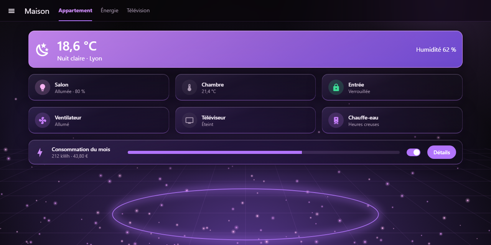
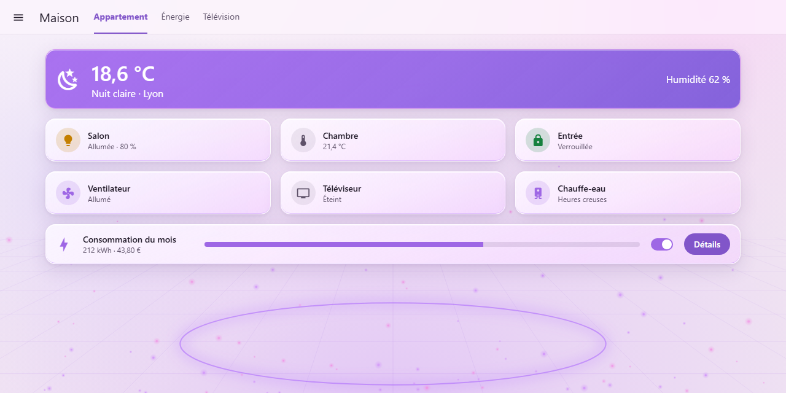
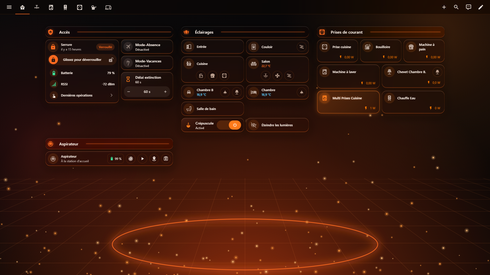
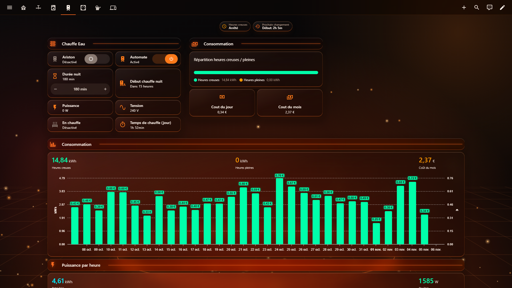
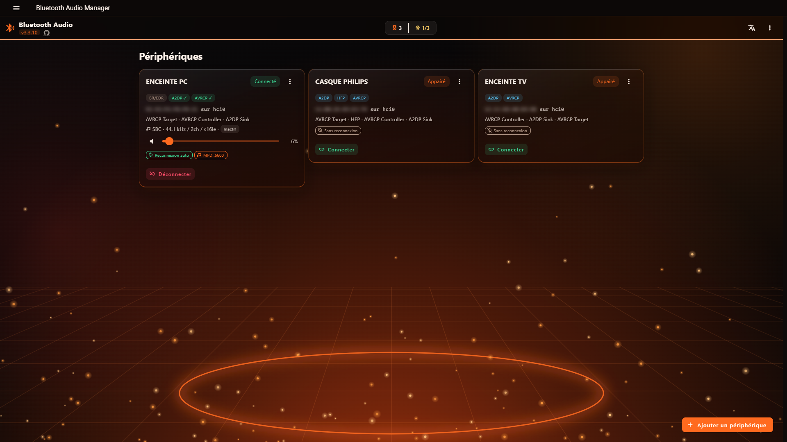
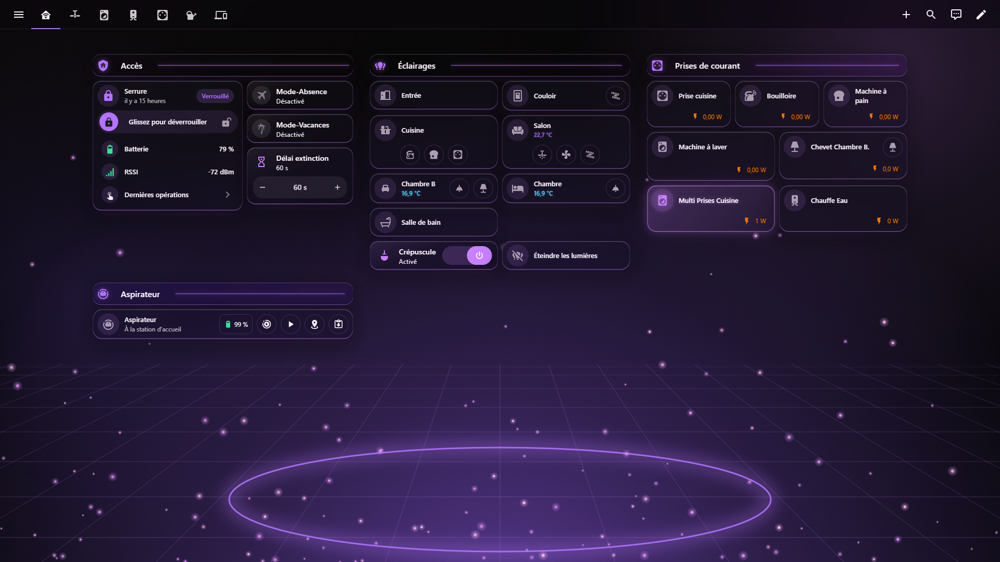
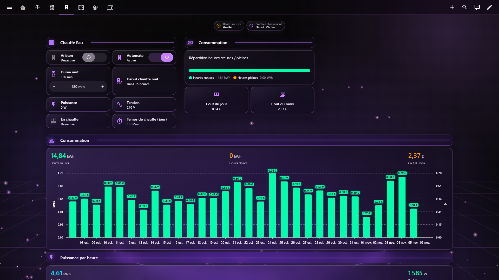
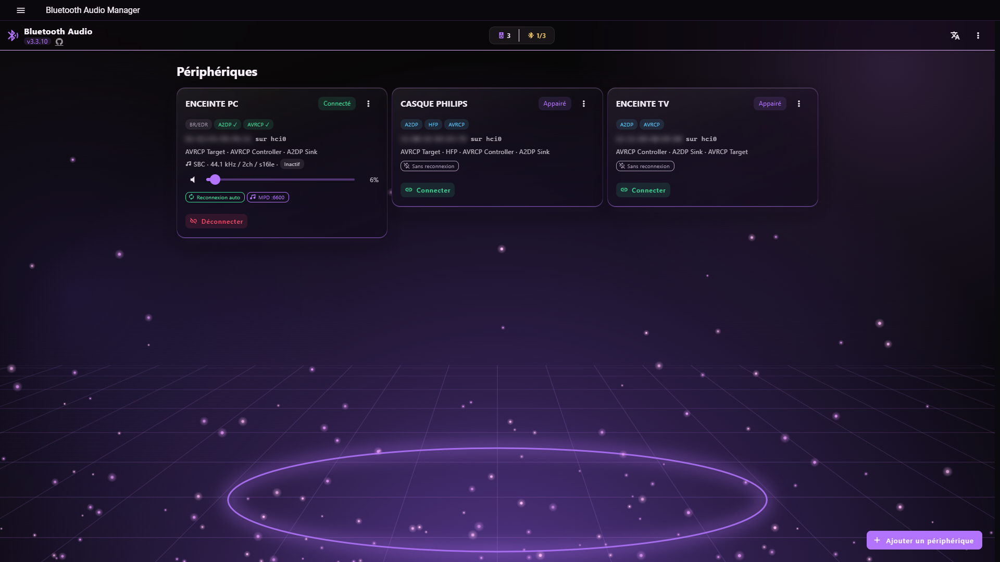

# Braise Glass

[](https://hacs.xyz/docs/faq/custom_repositories)
[](https://github.com/domodom30/ha-braise-glass-theme/actions/workflows/validate.yml)
[](https://github.com/domodom30/ha-braise-glass-theme/releases)
[](LICENSE)

An **ember glassmorphism** theme for Home Assistant: smoked black glass, glowing
orange edges and embers rising over a perspective floor. It comes with a dark mode,
a light mode named **Cendre** (ash), and a **Lite** variant without blur for slow
wall tablets. An **Amethyst** (purple) colourway of the same design is included.

| Dark | Light (Cendre) |
|---|---|
|  |  |
|  |  |

## Screenshots

### Braise Glass

**Dashboard**



**Water heater view**



**Bluetooth Audio Manager app**



### Braise Glass Amethyst

**Dashboard**



**Water heater view**



**Bluetooth Audio Manager app**



## Features

- **Four themes in one file**:
  - **Braise Glass**: dark and light modes, with frosted cards (`backdrop-filter`).
  - **Braise Glass Lite**: the same design without blur. The surfaces are more opaque, so the theme stays fast on old tablets, Fully Kiosk or a Raspberry Pi.
  - **Braise Glass Amethyst** and **Braise Glass Amethyst Lite**: the same two themes in purple. Backdrop, glows, glass tints and neutrals all turn purple; success, warning, error, info and named colours (`orange`, `amber`…) are left unchanged.
- **Built-in backdrop**: the ember scene (glow, perspective floor, glowing ring, embers) is embedded in the theme as an SVG. Nothing goes into `/config/www`, and there are no extra files to download.
- **Specular edges**: each card has a white highlight on top and an ember line at the bottom.
- **Readable**: WCAG contrast is checked in CI. Primary text reaches 18:1 in dark mode and 15:1 in light mode, and every state, named and chart colour reaches at least 3:1 on the background in both modes. Success, warning, error and info colours are kept away from the brand orange, so an alert never looks like an "on" state.
- **Complete coverage**: cards, header, sidebar, dialogs, inputs, switches, sliders, charts, energy colours, per-domain state colours and the map.
- **Custom cards**: Mushroom, Bubble Card and mini-media-player tokens.
- **Optional card-mod extras**:
  - A hover glow on cards.
  - Card classes: `glass-accent` (glowing hero card), `glass-strong`, `glass-clear`, `glass-flat` and `glass-glow`.
  - Support for `prefers-reduced-transparency` and `prefers-reduced-motion`.

## Installation

The theme is a single, self-contained YAML file: the backdrops are embedded as SVG
data URIs, so there is nothing to copy into `/config/www` and no `/local/` resource
to declare.

### Requirements

- Home Assistant **2024.8.0** or later.
- [HACS](https://hacs.xyz/docs/use/) for the automatic installation.
- [card-mod](https://github.com/thomasloven/lovelace-card-mod) 3.4+ is **optional** (only for the extras listed above).

### Step 1 — Automatic installation with HACS (recommended)

**One-click**: if [My Home Assistant](https://my.home-assistant.io/) is set up, click the
button below. It opens HACS on this repository and adds it as a custom repository for you.

[](https://my.home-assistant.io/redirect/hacs_repository/?owner=domodom30&repository=ha-braise-glass-theme&category=theme)

**Or step by step**:

1. In Home Assistant, open **HACS**.
2. Click **⋮** (top right) → **Custom repositories**.
3. Fill in the dialog:
   - **Repository**: `https://github.com/domodom30/ha-braise-glass-theme`
   - **Type**: **Theme**
4. Click **Add**, then close the dialog.
5. Search for **Braise Glass** in HACS and open it.
6. Click **Download** (bottom right), choose the latest version and confirm.
   HACS writes the file to `/config/themes/braise_glass/braise_glass.yaml`.
7. Reload the themes: **Developer tools → Actions**, run `frontend.reload_themes`
   (no restart needed if the themes folder is already enabled; otherwise, do Step 2 first).

```yaml
action: frontend.reload_themes
```

8. Select the theme (see [Usage](#usage)).

#### Updates

HACS checks the repository for new releases. When one is available, an update entity
appears in **Settings → Updates** (and in HACS). Install it, then run
`frontend.reload_themes` again and refresh the browser. Your theme selection is kept.

#### Uninstall

In HACS, open **Braise Glass → ⋮ → Remove**, then run `frontend.reload_themes`.
Users who had selected it fall back to the default theme.

### Step 2 — Enable the themes folder

Home Assistant only loads themes from a folder declared in `configuration.yaml`.
If your configuration does not already contain it, add:

```yaml
frontend:
  themes: !include_dir_merge_named themes
```

Then check the configuration (**Developer tools → YAML → Check configuration**) and
**restart** Home Assistant. This restart is needed only once; afterwards, new or
updated themes are picked up with a simple reload.

> If you already have `frontend: themes: !include_dir_merge_named themes`, skip this step.
> Do not declare `frontend:` twice.

### Alternative — Manual installation

1. Download `themes/braise_glass.yaml` from the [latest release](https://github.com/domodom30/ha-braise-glass-theme/releases/latest).
2. Copy it to `/config/themes/braise_glass/braise_glass.yaml` (Samba, File editor, Studio Code Server…).
3. Make sure Step 2 is done, then run `frontend.reload_themes`.

Manual installs are not updated automatically: repeat these steps for each new release.

### Troubleshooting

| Symptom | Fix |
|---|---|
| **Braise Glass** is missing from the theme list | Check that Step 2 is in `configuration.yaml`, that Home Assistant was restarted after adding it, and that the file is in `/config/themes/…`. Then run `frontend.reload_themes`. |
| The theme loads but looks unchanged after an update | Clear the browser cache or force a reload (Ctrl + F5). In the companion app: **Settings → Companion app → Troubleshooting → Reset frontend cache**. |
| Scrolling is slow on a wall tablet | Use **Braise Glass Lite**, which has the same design without blur. |
| The repository cannot be added in HACS | Make sure the type is **Theme** and that the URL has no trailing `.git` or `/`. |

## Usage

- **For yourself**: open **Profile → Theme**, then choose **Braise Glass**, **Braise Glass Amethyst** or one of their **Lite** versions. Leave the mode on *Auto* to follow the device, or force dark or light.
- **As the default for everyone**:

```yaml
action: frontend.set_theme
data:
  name: Braise Glass
  mode: dark   # or light
```

### card-mod classes (optional)

These classes require [card-mod](https://github.com/thomasloven/lovelace-card-mod) 3.4 or later. Without card-mod, the theme still works, using native variables only.

```yaml
card_mod:
  class: glass-accent   # glass-strong | glass-clear | glass-flat | glass-glow
```

### Bubble Card modules (optional)

The theme also defines `--blue-glass-on-rgb`, `--blue-glass-separator-rgb` and related
variables. Bubble Card modules can read them to tint "on" buttons and separators with
the active theme colour, so the same modules work across themes.

## Palette

| Role | Dark | Light (Cendre) |
|---|---|---|
| Background | `#0E0A09` | `#FBF4EE` |
| Card glass | smoked `#1A1210` | cream white |
| Text / secondary | `#FFF4EC` / `#B89D8C` | `#2B1A12` / `#6B5144` |
| Primary / accent | `#FF6A1F` / `#FF7A1A` | `#C2410C` / `#E0560F` |
| Lights on | `#FFC27A` | `#C47F00` |
| Success / warning / error / info | `#3DDC97` / `#FFD166` / `#FF4D6A` / `#5AC8FA` | `#15803D` / `#B45309` / `#DC2647` / `#0284C7` |

**Amethyst** keeps the same structure and contrast ratios. Primary / accent are
`#B274FC` / `#C880FD` in dark mode and `#8155C9` / `#9E67E5` in light mode.

## Development

| Path | Role |
|---|---|
| `src/braise_glass.yaml` | Editable source. `{{BACKDROP_DARK}}` and `{{BACKDROP_LIGHT}}` mark where the backdrops go. |
| `assets/*.svg` | Backdrops generated by `tools/make_backdrop.py` |
| `themes/braise_glass.yaml` | Distributed theme, generated by `tools/build_theme.py`. Do not edit it by hand. |
| `tools/recolor.py` | Hue rotation (OKLCH, perceived lightness kept) that produces the colour variants. Variants are declared in `VARIANTS` in `tools/build_theme.py`. |
| `tools/validate_theme.py` | Checks the schema, the `var(--glass-*)` references and the WCAG contrasts |
| `tools/preview.py` | Regenerates the README screenshots (headless Chrome) |

```bash
pip install pyyaml
python tools/make_backdrop.py   # only if the backdrop changes
python tools/build_theme.py
python tools/validate_theme.py
```

To add a colourway, add an entry to `VARIANTS` (name, YAML anchor prefix, hue rotation in degrees), then rebuild and validate.

CI runs the HACS validation. It also checks that `themes/braise_glass.yaml` matches `src/` and `assets/`.

## Credits

Inspired by the **Braise** (Ember) glass theme of the Domo TV app.

## License

[MIT](LICENSE)
