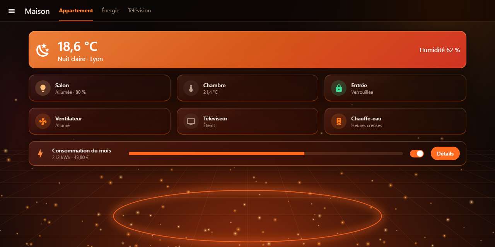
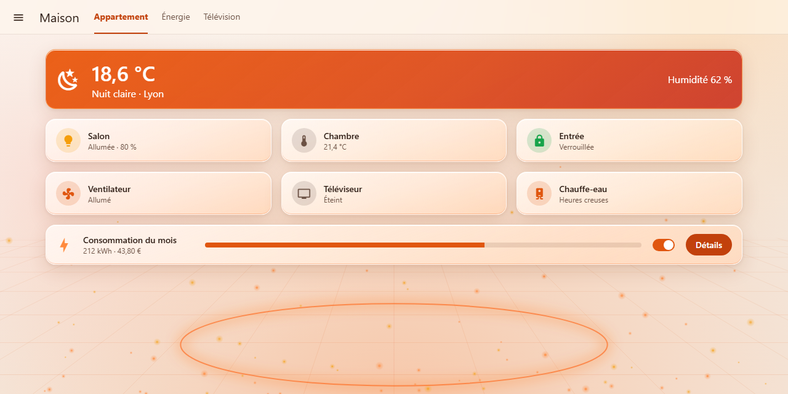

# Braise Glass

[](https://hacs.xyz/docs/faq/custom_repositories)
[](https://github.com/domodom30/ha-braise-glass-theme/actions/workflows/validate.yml)
[](https://github.com/domodom30/ha-braise-glass-theme/releases)
[](LICENSE)

An **ember glassmorphism** theme for Home Assistant: smoked black glass, glowing
orange edges and embers rising over a perspective floor. It comes with a dark mode,
a light mode named **Cendre** (ash), and a **Lite** variant without blur for slow
wall tablets.

> 🇫🇷 Thème **verre & braise** pour Home Assistant : verre noir fumé, bords orange
> incandescents, braises qui montent. Modes sombre et clair (« Cendre »), plus une
> variante **Lite** sans flou pour les tablettes lentes. Le reste de ce README est en anglais.

| Dark | Light (Cendre) |
|---|---|
|  |  |

## Features

- **Two themes in one file**:
  - **Braise Glass**: dark and light modes, with frosted cards (`backdrop-filter`).
  - **Braise Glass Lite**: the same design without blur. The surfaces are more opaque, so the theme stays fast on old tablets, Fully Kiosk or a Raspberry Pi.
- **Built-in backdrop**: the ember scene (glow, perspective floor, glowing ring, embers) is embedded in the theme as an SVG. Nothing goes into `/config/www`, and there are no extra files to download.
- **Specular edges**: each card has a white highlight on top and an ember line at the bottom.
- **Readable**: WCAG contrast is checked in CI. Primary text reaches 18:1 in dark mode and 15:1 in light mode. Success, warning, error and info colours are kept away from the brand orange, so an alert never looks like an "on" state.
- **Complete coverage**: cards, header, sidebar, dialogs, inputs, switches, sliders, charts, energy colours, per-domain state colours and the map.
- **Custom cards**: Mushroom, Bubble Card and mini-media-player tokens.
- **Optional card-mod extras**:
  - A hover glow on cards.
  - Card classes: `glass-accent` (glowing hero card), `glass-strong`, `glass-clear`, `glass-flat` and `glass-glow`.
  - Support for `prefers-reduced-transparency` and `prefers-reduced-motion`.

## Installation

### HACS (recommended)

1. In HACS, open **⋮ → Custom repositories**.
2. Add `https://github.com/domodom30/ha-braise-glass-theme` with the type **Theme**.
3. Search for **Braise Glass**, then click **Download**.
4. Make sure `configuration.yaml` loads the themes folder (see below), then restart Home Assistant or run the `frontend.reload_themes` action.

[](https://my.home-assistant.io/redirect/hacs_repository/?owner=domodom30&repository=ha-braise-glass-theme&category=theme)

### Manual

Copy `themes/braise_glass.yaml` to `/config/themes/braise_glass/`, then reload the themes.

### `configuration.yaml`

```yaml
frontend:
  themes: !include_dir_merge_named themes
```

## Usage

- **For yourself**: open **Profile → Theme**, then choose **Braise Glass** or **Braise Glass Lite**. Leave the mode on *Auto* to follow the device, or force dark or light.
- **As the default for everyone**:

```yaml
action: frontend.set_theme
data:
  name: Braise Glass
  mode: dark   # or light
```

### card-mod classes (optional)

These classes require [card-mod](https://github.com/thomasloven/lovelace-card-mod) 3.4 or later. Without card-mod, the theme still works, using native variables only.

```yaml
card_mod:
  class: glass-accent   # glass-strong | glass-clear | glass-flat | glass-glow
```

### Bubble Card modules (optional)

The theme also defines `--blue-glass-on-rgb`, `--blue-glass-separator-rgb` and related
variables. Bubble Card modules can read them to tint "on" buttons and separators with
the active theme colour, so the same modules work across themes.

## Palette

| Role | Dark | Light (Cendre) |
|---|---|---|
| Background | `#0E0A09` | `#FBF4EE` |
| Card glass | smoked `#1A1210` | cream white |
| Text / secondary | `#FFF4EC` / `#B89D8C` | `#2B1A12` / `#6B5144` |
| Primary / accent | `#FF6A1F` / `#FF7A1A` | `#C2410C` / `#E0560F` |
| Lights on | `#FFC27A` | `#F59E0B` |
| Success / warning / error / info | `#3DDC97` / `#FFD166` / `#FF4D6A` / `#5AC8FA` | `#16A34A` / `#D97706` / `#DC2647` / `#0284C7` |

## Development

| Path | Role |
|---|---|
| `src/braise_glass.yaml` | Editable source. `{{BACKDROP_DARK}}` and `{{BACKDROP_LIGHT}}` mark where the backdrops go. |
| `assets/*.svg` | Backdrops generated by `tools/make_backdrop.py` |
| `themes/braise_glass.yaml` | Distributed theme, generated by `tools/build_theme.py`. Do not edit it by hand. |
| `tools/validate_theme.py` | Checks the schema, the `var(--glass-*)` references and the WCAG contrasts |
| `tools/preview.py` | Regenerates the README screenshots (headless Chrome) |

```bash
pip install pyyaml
python tools/make_backdrop.py   # only if the backdrop changes
python tools/build_theme.py
python tools/validate_theme.py
```

CI runs the HACS validation. It also checks that `themes/braise_glass.yaml` matches `src/` and `assets/`.

## Credits

Inspired by the **Braise** (Ember) glass theme of the Domo TV app.

## License

[MIT](LICENSE)
